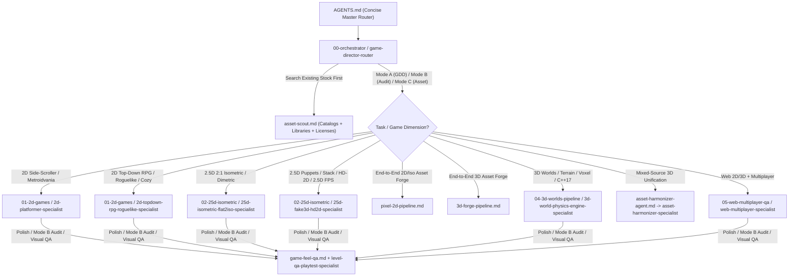

# Hierarchical Agent Tree & Orchestration Index (`agents/`)

Welcome to the **`game-dev-skills` Agent Tree**. Because this hub spans **2D, 2.5D (Isometric / Fake-3D / Sprite-Stacking / HD-2D / Retro FPS), and 3D** across **69 top-level skills**, **79 `awesome-gamedev` sub-skills**, **78 `claude-code-game-studios` subskills**, **24 Reverse-DNS libraries**, **5 asset collections**, and **35 Python CLI tools**, agents never load everything blindly.

Instead, every task enters at the root (`AGENTS.md` -> `agents/`) through either one of the **5 Root Cross-Tool Pipeline Agents** or the **Hierarchical Game-Domain Tree**:

```text
AGENTS.md (Concise Master Summary & Root Router)
└── agents/
    ├── README.md                                          # This Master Agent Tree Map & 69-Skill Coverage Ledger
    ├── asset-scout.md                                     # [Pipeline 1] Multi-Catalog Discovery (2D/3D/VFX/Audio + License Check)
    ├── pixel-2d-pipeline.md                               # [Pipeline 2] pixel_snapper -> flat2iso -> normals -> slicer -> vfx -> godot_pixel_tool
    ├── 3d-forge-pipeline.md                               # [Pipeline 3] abo/threejs/polyspoon/sand3d -> blender_kiln -> glb_forge -> harmonizer
    ├── game-feel-qa.md                                    # [Pipeline 4] hit_feedback + forgiveness + camera + pixel_perfect + level + voxl Audit
    ├── asset-harmonizer-agent.md                          # [Pipeline 5] Root Compatibility Entrypoint -> 6-Stage Mixed-Source 3D Harmonizer
    │
    ├── 00-orchestrator/
    │   └── game-director-router.md                        # Mode A/B/C Gate, Engine Fingerprinting & Multi-Branch Dispatch
    ├── 01-2d-games/
    │   ├── 2d-platformer-specialist.md                    # Physics, Forgiveness, Camera, Parallax, Hitstop, BFS Jump Validation
    │   └── 2d-topdown-rpg-roguelike-specialist.md         # Y-Sort, Wang Tiles, Water, FOV/LOS, See-Through, Loot, Crafting, AI, Narrative
    ├── 02-25d-isometric/
    │   ├── 25d-isometric-flat2iso-specialist.md           # 2:1 Dimetric Isometric (`flat2iso.py` + `flat2iso.html` Studio), Iso Normals, Sorting
    │   └── 25d-fake3d-hd2d-specialist.md                  # Godot Fake-3D Puppets, Sprite Stacking, HD-2D Billboards, Retro 2.5D FPS / PSX
    ├── 03-2d-asset-vfx-forge/
    │   ├── pixel-character-creature-forge.md              # 1.4M CC0 Atlas, LPC Modular Sheets, Procedural Monsters/Pets, AI Still->Video->Strip
    │   ├── pixel-cleanup-normals-pipeline.md              # Matte Removal, Grid Snap, Dithering, 2D Normals (_n.png), Slice, Pixel-Perfect QA
    │   └── vfx-shaders-juice-specialist.md                # 5-Family SDF VFX, 244+ PixelFX, Hitstop/Flash/Shake, DSP SFX, Effekseer, Three-Quarks
    ├── 04-3d-worlds-pipeline/
    │   ├── 3d-model-material-forge.md                     # ABO/Sand3D/ThreeJS Catalogs, Polyspoon, Blender Kiln/MCP, TripoSR, Material Maker, GLB Forge
    │   ├── 3d-world-physics-engine-specialist.md          # Godot 3D (Terrain3D, Voxel, Jolt, PhantomCam, LimboAI) & C++17 (The Forge, Jolt, Ozz, Recast)
    │   └── asset-harmonizer-specialist.md                 # Full 6-Stage Mixed-Source 3D Asset Harmonization Pipeline
    └── 05-web-multiplayer-qa/
        ├── web-multiplayer-specialist.md                  # Phaser 3 + React + Vite, Three.js, 67js WebGL2 & MP4 Export, Colyseus v0.18, Yuka JS AI
        └── level-qa-playtest-specialist.md                # Human-First Level BFS Plumbing, Voxl 60FPS Stream QA, Godot MCP, Studio Release Gates
```

---

## Visual Orchestration Flow



---

## Quick Routing Matrix (Game Type × Discipline -> Agent File)

| User Intent / Game Type | Primary Agent | Supporting Handoff Chain |
|---|---|---|
| **New game pitch / unsure engine / full studio audit** | [`00-orchestrator/game-director-router.md`](00-orchestrator/game-director-router.md) | Dispatches to root pipeline agents & Branches `01`–`05` |
| **Search 2D/3D/VFX/Audio across all catalogs with licenses** | [`asset-scout.md`](asset-scout.md) | Feeds candidates into [`pixel-2d-pipeline.md`](pixel-2d-pipeline.md) or [`3d-forge-pipeline.md`](3d-forge-pipeline.md) |
| **End-to-end 2D/2.5D pixel asset chain (`snap -> iso -> _n -> strip -> vfx -> import`)** | [`pixel-2d-pipeline.md`](pixel-2d-pipeline.md) | Connects `03-2d-asset-vfx-forge/*` + `25d-isometric-flat2iso-specialist` |
| **End-to-end 3D forge (`catalog/polyspoon/sand3d -> kiln -> glb_forge -> harmonize`)** | [`3d-forge-pipeline.md`](3d-forge-pipeline.md) | Connects `04-3d-worlds-pipeline/*` |
| **Audit existing game project (`hit_feedback` + `forgiveness` + `camera` + `pixel` + `level` + `voxl`)** | [`game-feel-qa.md`](game-feel-qa.md) | Hands final sign-off to `level-qa-playtest-specialist` |
| **2D / 2.5D Platformer, Action-Platformer, Metroidvania** | [`01-2d-games/2d-platformer-specialist.md`](01-2d-games/2d-platformer-specialist.md) | `pixel-2d-pipeline` → `vfx-shaders-juice-specialist` → `game-feel-qa` |
| **2D Top-Down RPG, Roguelike, Survival, Cozy Sim** | [`01-2d-games/2d-topdown-rpg-roguelike-specialist.md`](01-2d-games/2d-topdown-rpg-roguelike-specialist.md) | `pixel-character-creature-forge` → `pixel-2d-pipeline` → `game-feel-qa` |
| **2:1 Isometric (Dimetric) Pixel Art / Tactics / City Builder** | [`02-25d-isometric/25d-isometric-flat2iso-specialist.md`](02-25d-isometric/25d-isometric-flat2iso-specialist.md) | `pixel-cleanup-normals-pipeline` → `2d-topdown-rpg-roguelike-specialist` → `game-feel-qa` |
| **2.5D Fake-3D Puppets, Sprite Stacking, HD-2D, Retro PSX/Doom FPS** | [`02-25d-isometric/25d-fake3d-hd2d-specialist.md`](02-25d-isometric/25d-fake3d-hd2d-specialist.md) | `pixel-cleanup-normals-pipeline` → `vfx-shaders-juice-specialist` → `game-feel-qa` |
| **2D Sprites, Characters, LPC Sheets, Monsters, Pets, AI Sprites** | [`03-2d-asset-vfx-forge/pixel-character-creature-forge.md`](03-2d-asset-vfx-forge/pixel-character-creature-forge.md) | `pixel-cleanup-normals-pipeline` (grid snap, `_n.png`, `_stripN.png`) |
| **Sprite Cleanup, Grid Snapping, Dithering, 2D Normals, Godot/GM Imports** | [`03-2d-asset-vfx-forge/pixel-cleanup-normals-pipeline.md`](03-2d-asset-vfx-forge/pixel-cleanup-normals-pipeline.md) | Hands engine-ready textures to Branch `01` or `02` |
| **Combat Feel, Hitstop, SDF VFX, PixelFX, Audio SFX, Effekseer, Three-Quarks** | [`03-2d-asset-vfx-forge/vfx-shaders-juice-specialist.md`](03-2d-asset-vfx-forge/vfx-shaders-juice-specialist.md) | Triggered by any gameplay branch (`01`, `02`, `04`, `05`) |
| **3D Models, Catalog GLBs, Polyspoon, Blender Kiln/MCP, PBR, TripoSR** | [`04-3d-worlds-pipeline/3d-model-material-forge.md`](04-3d-worlds-pipeline/3d-model-material-forge.md) | `asset-harmonizer-specialist` → `3d-world-physics-engine-specialist` |
| **3D Open Worlds, Voxel Worlds, Jolt Physics, C++17 Engines** | [`04-3d-worlds-pipeline/3d-world-physics-engine-specialist.md`](04-3d-worlds-pipeline/3d-world-physics-engine-specialist.md) | `3d-forge-pipeline` → `vfx-shaders-juice-specialist` → `level-qa-playtest-specialist` |
| **Unifying Mixed-Source 3D Assets (Scale/Pivot/Texel/Palette/QA)** | [`04-3d-worlds-pipeline/asset-harmonizer-specialist.md`](04-3d-worlds-pipeline/asset-harmonizer-specialist.md) | Root entrypoint: [`asset-harmonizer-agent.md`](asset-harmonizer-agent.md) |
| **Browser Games (Phaser/Three.js/67js), Colyseus Multiplayer, Yuka AI** | [`05-web-multiplayer-qa/web-multiplayer-specialist.md`](05-web-multiplayer-qa/web-multiplayer-specialist.md) | `vfx-shaders-juice-specialist` → `level-qa-playtest-specialist` |
| **Level Validation (BFS), 60 FPS Visual QA (Voxl), Godot MCP, Shipping** | [`05-web-multiplayer-qa/level-qa-playtest-specialist.md`](05-web-multiplayer-qa/level-qa-playtest-specialist.md) | Final QA sign-off gate for all branches |

---

## Standard Inter-Agent Handoff Contract

Every agent chain passes a lightweight **Handoff Receipt** (or `--json` output from CLI tools) so downstream specialists never guess file paths or dimensions:
1. **Context Header:** `Mode (A/B/C)` · `Engine` (`Godot 4 | GameMaker | Phaser/Three.js | Unity | Unreal | C++17`) · `Dimension` (`2D | 2.5D Iso | 2.5D Fake3D | HD-2D | 3D`).
2. **Design Lock:** Palette ID/Hex list, Base Resolution & PPU/Texel Target (`16/32/48 px` or `px/cm`), Pivot Convention (`Bottom-Center` for 2D/Iso, `Base-Center` for 3D).
3. **Produced Artifacts:** Exact file paths (`_stripN.png`, `_n.png`, `.glb`, `.tres`, `.import`, `.gdshader`) + CLI `--json` summary.
4. **QA Gate Status:** Verification command run (`pixel_perfect.py`, `godot_pixel_tool.py check-integrity`, `asset_harmonizer.py qa`, `level_pipeline.py validate`, `voxl_client.py screenshot`).

---

## Complete Coverage Ledger (69 Top-Level Skills & 35 Python CLI Tools)

### All 69 Top-Level Skills (`skills/*/SKILL.md`)

| Skill | Primary Owning Agent | Secondary / Cross-Branch Agent |
|---|---|---|
| `asset-harmonizer` | [`04-3d-worlds-pipeline/asset-harmonizer-specialist.md`](04-3d-worlds-pipeline/asset-harmonizer-specialist.md) | [`asset-harmonizer-agent.md`](asset-harmonizer-agent.md) |
| `atmospheric-perspective` | [`01-2d-games/2d-platformer-specialist.md`](01-2d-games/2d-platformer-specialist.md) | [`02-25d-isometric/25d-fake3d-hd2d-specialist.md`](02-25d-isometric/25d-fake3d-hd2d-specialist.md) |
| `awesome-gamedev` | [`00-orchestrator/game-director-router.md`](00-orchestrator/game-director-router.md) | [`05-web-multiplayer-qa/web-multiplayer-specialist.md`](05-web-multiplayer-qa/web-multiplayer-specialist.md) |
| `backgroundremover` | [`03-2d-asset-vfx-forge/pixel-cleanup-normals-pipeline.md`](03-2d-asset-vfx-forge/pixel-cleanup-normals-pipeline.md) | [`03-2d-asset-vfx-forge/pixel-character-creature-forge.md`](03-2d-asset-vfx-forge/pixel-character-creature-forge.md) |
| `blender-kiln` | [`04-3d-worlds-pipeline/3d-model-material-forge.md`](04-3d-worlds-pipeline/3d-model-material-forge.md) | [`04-3d-worlds-pipeline/asset-harmonizer-specialist.md`](04-3d-worlds-pipeline/asset-harmonizer-specialist.md) |
| `build-67js-scene` | [`05-web-multiplayer-qa/web-multiplayer-specialist.md`](05-web-multiplayer-qa/web-multiplayer-specialist.md) | — |
| `camera-follow-2d` | [`01-2d-games/2d-platformer-specialist.md`](01-2d-games/2d-platformer-specialist.md) | [`01-2d-games/2d-topdown-rpg-roguelike-specialist.md`](01-2d-games/2d-topdown-rpg-roguelike-specialist.md) |
| `claude-code-game-studios` | [`00-orchestrator/game-director-router.md`](00-orchestrator/game-director-router.md) | [`05-web-multiplayer-qa/level-qa-playtest-specialist.md`](05-web-multiplayer-qa/level-qa-playtest-specialist.md) |
| `codeart2d` | [`03-2d-asset-vfx-forge/pixel-character-creature-forge.md`](03-2d-asset-vfx-forge/pixel-character-creature-forge.md) | — |
| `colyseus` | [`05-web-multiplayer-qa/web-multiplayer-specialist.md`](05-web-multiplayer-qa/web-multiplayer-specialist.md) | — |
| `crafting-systems` | [`01-2d-games/2d-topdown-rpg-roguelike-specialist.md`](01-2d-games/2d-topdown-rpg-roguelike-specialist.md) | — |
| `creature-gen` | [`03-2d-asset-vfx-forge/pixel-character-creature-forge.md`](03-2d-asset-vfx-forge/pixel-character-creature-forge.md) | — |
| `dialogic` | [`01-2d-games/2d-topdown-rpg-roguelike-specialist.md`](01-2d-games/2d-topdown-rpg-roguelike-specialist.md) | — |
| `effekseer` | [`03-2d-asset-vfx-forge/vfx-shaders-juice-specialist.md`](03-2d-asset-vfx-forge/vfx-shaders-juice-specialist.md) | [`04-3d-worlds-pipeline/3d-world-physics-engine-specialist.md`](04-3d-worlds-pipeline/3d-world-physics-engine-specialist.md) |
| `flat2iso` | [`02-25d-isometric/25d-isometric-flat2iso-specialist.md`](02-25d-isometric/25d-isometric-flat2iso-specialist.md) | — |
| `game-engineering` | [`00-orchestrator/game-director-router.md`](00-orchestrator/game-director-router.md) | [`01-2d-games/2d-topdown-rpg-roguelike-specialist.md`](01-2d-games/2d-topdown-rpg-roguelike-specialist.md) |
| `game-feel` | [`03-2d-asset-vfx-forge/vfx-shaders-juice-specialist.md`](03-2d-asset-vfx-forge/vfx-shaders-juice-specialist.md) | [`01-2d-games/2d-platformer-specialist.md`](01-2d-games/2d-platformer-specialist.md), [`01-2d-games/2d-topdown-rpg-roguelike-specialist.md`](01-2d-games/2d-topdown-rpg-roguelike-specialist.md) |
| `generate2dmap` | [`01-2d-games/2d-topdown-rpg-roguelike-specialist.md`](01-2d-games/2d-topdown-rpg-roguelike-specialist.md) | [`02-25d-isometric/25d-isometric-flat2iso-specialist.md`](02-25d-isometric/25d-isometric-flat2iso-specialist.md) |
| `generate2dmedia` | [`03-2d-asset-vfx-forge/pixel-character-creature-forge.md`](03-2d-asset-vfx-forge/pixel-character-creature-forge.md) | — |
| `generate2dsprite` | [`03-2d-asset-vfx-forge/pixel-character-creature-forge.md`](03-2d-asset-vfx-forge/pixel-character-creature-forge.md) | — |
| `glb-forge` | [`04-3d-worlds-pipeline/3d-model-material-forge.md`](04-3d-worlds-pipeline/3d-model-material-forge.md) | [`04-3d-worlds-pipeline/asset-harmonizer-specialist.md`](04-3d-worlds-pipeline/asset-harmonizer-specialist.md) |
| `godot` | [`01-2d-games/2d-platformer-specialist.md`](01-2d-games/2d-platformer-specialist.md) | [`01-2d-games/2d-topdown-rpg-roguelike-specialist.md`](01-2d-games/2d-topdown-rpg-roguelike-specialist.md), [`04-3d-worlds-pipeline/3d-world-physics-engine-specialist.md`](04-3d-worlds-pipeline/3d-world-physics-engine-specialist.md) |
| `godot-fake-3d-character` | [`02-25d-isometric/25d-fake3d-hd2d-specialist.md`](02-25d-isometric/25d-fake3d-hd2d-specialist.md) | — |
| `godot-jolt` | [`04-3d-worlds-pipeline/3d-world-physics-engine-specialist.md`](04-3d-worlds-pipeline/3d-world-physics-engine-specialist.md) | — |
| `godot-mcp` | [`05-web-multiplayer-qa/level-qa-playtest-specialist.md`](05-web-multiplayer-qa/level-qa-playtest-specialist.md) | — |
| `godot-pixel-pipeline` | [`02-25d-isometric/25d-fake3d-hd2d-specialist.md`](02-25d-isometric/25d-fake3d-hd2d-specialist.md) | [`03-2d-asset-vfx-forge/pixel-cleanup-normals-pipeline.md`](03-2d-asset-vfx-forge/pixel-cleanup-normals-pipeline.md), [`05-web-multiplayer-qa/level-qa-playtest-specialist.md`](05-web-multiplayer-qa/level-qa-playtest-specialist.md) |
| `godot-voxel` | [`04-3d-worlds-pipeline/3d-world-physics-engine-specialist.md`](04-3d-worlds-pipeline/3d-world-physics-engine-specialist.md) | — |
| `hit-feedback` | [`03-2d-asset-vfx-forge/vfx-shaders-juice-specialist.md`](03-2d-asset-vfx-forge/vfx-shaders-juice-specialist.md) | [`01-2d-games/2d-platformer-specialist.md`](01-2d-games/2d-platformer-specialist.md), [`01-2d-games/2d-topdown-rpg-roguelike-specialist.md`](01-2d-games/2d-topdown-rpg-roguelike-specialist.md) |
| `image-to-pixel` | [`03-2d-asset-vfx-forge/pixel-cleanup-normals-pipeline.md`](03-2d-asset-vfx-forge/pixel-cleanup-normals-pipeline.md) | [`04-3d-worlds-pipeline/asset-harmonizer-specialist.md`](04-3d-worlds-pipeline/asset-harmonizer-specialist.md) |
| `jolt-physics` | [`04-3d-worlds-pipeline/3d-world-physics-engine-specialist.md`](04-3d-worlds-pipeline/3d-world-physics-engine-specialist.md) | — |
| `ldtk` | [`01-2d-games/2d-topdown-rpg-roguelike-specialist.md`](01-2d-games/2d-topdown-rpg-roguelike-specialist.md) | [`01-2d-games/2d-platformer-specialist.md`](01-2d-games/2d-platformer-specialist.md) |
| `level-pipeline` | [`05-web-multiplayer-qa/level-qa-playtest-specialist.md`](05-web-multiplayer-qa/level-qa-playtest-specialist.md) | [`01-2d-games/2d-platformer-specialist.md`](01-2d-games/2d-platformer-specialist.md) |
| `limboai` | [`01-2d-games/2d-topdown-rpg-roguelike-specialist.md`](01-2d-games/2d-topdown-rpg-roguelike-specialist.md) | [`04-3d-worlds-pipeline/3d-world-physics-engine-specialist.md`](04-3d-worlds-pipeline/3d-world-physics-engine-specialist.md) |
| `loot-window` | [`01-2d-games/2d-topdown-rpg-roguelike-specialist.md`](01-2d-games/2d-topdown-rpg-roguelike-specialist.md) | [`03-2d-asset-vfx-forge/pixel-cleanup-normals-pipeline.md`](03-2d-asset-vfx-forge/pixel-cleanup-normals-pipeline.md) |
| `lpc-character-generator` | [`03-2d-asset-vfx-forge/pixel-character-creature-forge.md`](03-2d-asset-vfx-forge/pixel-character-creature-forge.md) | — |
| `material-maker` | [`04-3d-worlds-pipeline/3d-model-material-forge.md`](04-3d-worlds-pipeline/3d-model-material-forge.md) | [`04-3d-worlds-pipeline/asset-harmonizer-specialist.md`](04-3d-worlds-pipeline/asset-harmonizer-specialist.md) |
| `mcp-for-blender` | [`04-3d-worlds-pipeline/3d-model-material-forge.md`](04-3d-worlds-pipeline/3d-model-material-forge.md) | — |
| `mesh-splatting` | [`04-3d-worlds-pipeline/3d-model-material-forge.md`](04-3d-worlds-pipeline/3d-model-material-forge.md) | — |
| `ozz-animation` | [`04-3d-worlds-pipeline/3d-world-physics-engine-specialist.md`](04-3d-worlds-pipeline/3d-world-physics-engine-specialist.md) | — |
| `phantom-camera` | [`04-3d-worlds-pipeline/3d-world-physics-engine-specialist.md`](04-3d-worlds-pipeline/3d-world-physics-engine-specialist.md) | [`02-25d-isometric/25d-fake3d-hd2d-specialist.md`](02-25d-isometric/25d-fake3d-hd2d-specialist.md) |
| `pixel-art-atlas` | [`03-2d-asset-vfx-forge/pixel-character-creature-forge.md`](03-2d-asset-vfx-forge/pixel-character-creature-forge.md) | — |
| `pixel-asset-manager` | [`03-2d-asset-vfx-forge/pixel-character-creature-forge.md`](03-2d-asset-vfx-forge/pixel-character-creature-forge.md) | — |
| `pixel-perfect` | [`03-2d-asset-vfx-forge/pixel-cleanup-normals-pipeline.md`](03-2d-asset-vfx-forge/pixel-cleanup-normals-pipeline.md) | [`01-2d-games/2d-platformer-specialist.md`](01-2d-games/2d-platformer-specialist.md), [`02-25d-isometric/25d-isometric-flat2iso-specialist.md`](02-25d-isometric/25d-isometric-flat2iso-specialist.md), [`05-web-multiplayer-qa/level-qa-playtest-specialist.md`](05-web-multiplayer-qa/level-qa-playtest-specialist.md) |
| `pixel-snapper` | [`03-2d-asset-vfx-forge/pixel-cleanup-normals-pipeline.md`](03-2d-asset-vfx-forge/pixel-cleanup-normals-pipeline.md) | [`02-25d-isometric/25d-isometric-flat2iso-specialist.md`](02-25d-isometric/25d-isometric-flat2iso-specialist.md) |
| `pixelfx` | [`03-2d-asset-vfx-forge/vfx-shaders-juice-specialist.md`](03-2d-asset-vfx-forge/vfx-shaders-juice-specialist.md) | — |
| `pixelorama` | [`03-2d-asset-vfx-forge/pixel-cleanup-normals-pipeline.md`](03-2d-asset-vfx-forge/pixel-cleanup-normals-pipeline.md) | — |
| `platformer-forgiveness` | [`01-2d-games/2d-platformer-specialist.md`](01-2d-games/2d-platformer-specialist.md) | — |
| `polyspoon` | [`04-3d-worlds-pipeline/3d-model-material-forge.md`](04-3d-worlds-pipeline/3d-model-material-forge.md) | — |
| `recastnavigation` | [`04-3d-worlds-pipeline/3d-world-physics-engine-specialist.md`](04-3d-worlds-pipeline/3d-world-physics-engine-specialist.md) | — |
| `render-67js-media` | [`05-web-multiplayer-qa/web-multiplayer-specialist.md`](05-web-multiplayer-qa/web-multiplayer-specialist.md) | — |
| `sand3d-to-roblox` | [`04-3d-worlds-pipeline/3d-model-material-forge.md`](04-3d-worlds-pipeline/3d-model-material-forge.md) | — |
| `see-through` | [`01-2d-games/2d-topdown-rpg-roguelike-specialist.md`](01-2d-games/2d-topdown-rpg-roguelike-specialist.md) | [`02-25d-isometric/25d-isometric-flat2iso-specialist.md`](02-25d-isometric/25d-isometric-flat2iso-specialist.md), [`02-25d-isometric/25d-fake3d-hd2d-specialist.md`](02-25d-isometric/25d-fake3d-hd2d-specialist.md), [`03-2d-asset-vfx-forge/vfx-shaders-juice-specialist.md`](03-2d-asset-vfx-forge/vfx-shaders-juice-specialist.md) |
| `shadowcasting` | [`01-2d-games/2d-topdown-rpg-roguelike-specialist.md`](01-2d-games/2d-topdown-rpg-roguelike-specialist.md) | [`02-25d-isometric/25d-isometric-flat2iso-specialist.md`](02-25d-isometric/25d-isometric-flat2iso-specialist.md) |
| `sprite-gen` | [`03-2d-asset-vfx-forge/pixel-character-creature-forge.md`](03-2d-asset-vfx-forge/pixel-character-creature-forge.md) | — |
| `sprite-stacking` | [`02-25d-isometric/25d-fake3d-hd2d-specialist.md`](02-25d-isometric/25d-fake3d-hd2d-specialist.md) | — |
| `spritefusion-pixel-snapper` | [`03-2d-asset-vfx-forge/pixel-cleanup-normals-pipeline.md`](03-2d-asset-vfx-forge/pixel-cleanup-normals-pipeline.md) | — |
| `spritefusion-sprite-normals` | [`03-2d-asset-vfx-forge/pixel-cleanup-normals-pipeline.md`](03-2d-asset-vfx-forge/pixel-cleanup-normals-pipeline.md) | [`02-25d-isometric/25d-isometric-flat2iso-specialist.md`](02-25d-isometric/25d-isometric-flat2iso-specialist.md), [`02-25d-isometric/25d-fake3d-hd2d-specialist.md`](02-25d-isometric/25d-fake3d-hd2d-specialist.md) |
| `sustainable-indie-dev` | [`00-orchestrator/game-director-router.md`](00-orchestrator/game-director-router.md) | [`05-web-multiplayer-qa/level-qa-playtest-specialist.md`](05-web-multiplayer-qa/level-qa-playtest-specialist.md) |
| `terrain3d` | [`04-3d-worlds-pipeline/3d-world-physics-engine-specialist.md`](04-3d-worlds-pipeline/3d-world-physics-engine-specialist.md) | — |
| `the-forge` | [`04-3d-worlds-pipeline/3d-world-physics-engine-specialist.md`](04-3d-worlds-pipeline/3d-world-physics-engine-specialist.md) | — |
| `three-quarks` | [`03-2d-asset-vfx-forge/vfx-shaders-juice-specialist.md`](03-2d-asset-vfx-forge/vfx-shaders-juice-specialist.md) | [`05-web-multiplayer-qa/web-multiplayer-specialist.md`](05-web-multiplayer-qa/web-multiplayer-specialist.md) |
| `triposr` | [`04-3d-worlds-pipeline/3d-model-material-forge.md`](04-3d-worlds-pipeline/3d-model-material-forge.md) | — |
| `vfx-forge` | [`03-2d-asset-vfx-forge/vfx-shaders-juice-specialist.md`](03-2d-asset-vfx-forge/vfx-shaders-juice-specialist.md) | [`02-25d-isometric/25d-isometric-flat2iso-specialist.md`](02-25d-isometric/25d-isometric-flat2iso-specialist.md) |
| `video2dsprite` | [`03-2d-asset-vfx-forge/pixel-character-creature-forge.md`](03-2d-asset-vfx-forge/pixel-character-creature-forge.md) | — |
| `voxl` | [`05-web-multiplayer-qa/level-qa-playtest-specialist.md`](05-web-multiplayer-qa/level-qa-playtest-specialist.md) | — |
| `wang-tiles` | [`01-2d-games/2d-topdown-rpg-roguelike-specialist.md`](01-2d-games/2d-topdown-rpg-roguelike-specialist.md) | [`02-25d-isometric/25d-isometric-flat2iso-specialist.md`](02-25d-isometric/25d-isometric-flat2iso-specialist.md) |
| `water-shorelines` | [`01-2d-games/2d-topdown-rpg-roguelike-specialist.md`](01-2d-games/2d-topdown-rpg-roguelike-specialist.md) | [`02-25d-isometric/25d-isometric-flat2iso-specialist.md`](02-25d-isometric/25d-isometric-flat2iso-specialist.md), [`03-2d-asset-vfx-forge/vfx-shaders-juice-specialist.md`](03-2d-asset-vfx-forge/vfx-shaders-juice-specialist.md) |
| `web-2d-games` | [`05-web-multiplayer-qa/web-multiplayer-specialist.md`](05-web-multiplayer-qa/web-multiplayer-specialist.md) | [`01-2d-games/2d-platformer-specialist.md`](01-2d-games/2d-platformer-specialist.md) |
| `yuka` | [`05-web-multiplayer-qa/web-multiplayer-specialist.md`](05-web-multiplayer-qa/web-multiplayer-specialist.md) | [`01-2d-games/2d-topdown-rpg-roguelike-specialist.md`](01-2d-games/2d-topdown-rpg-roguelike-specialist.md) |

### All 35 Python CLI Tools (`tools/*.py`)

> **Strict `tools/` Boundary:** `tools/` strictly forbids project-specific, game-specific, or character/boss/lore-specific scripts. Keep only reusable, project-agnostic CLI tools in `tools/`; place all game-specific scripts under `projects/<project_name>/`.

| Tool | Owning Agent(s) |
|---|---|
| `tools/abo_manager.py` | [`04-3d-worlds-pipeline/3d-model-material-forge.md`](04-3d-worlds-pipeline/3d-model-material-forge.md) |
| `tools/asset_harmonizer.py` | [`04-3d-worlds-pipeline/asset-harmonizer-specialist.md`](04-3d-worlds-pipeline/asset-harmonizer-specialist.md), [`asset-harmonizer-agent.md`](asset-harmonizer-agent.md) |
| `tools/asset_search.py` | [`00-orchestrator/game-director-router.md`](00-orchestrator/game-director-router.md), [`03-2d-asset-vfx-forge/pixel-character-creature-forge.md`](03-2d-asset-vfx-forge/pixel-character-creature-forge.md), [`01-2d-games/2d-topdown-rpg-roguelike-specialist.md`](01-2d-games/2d-topdown-rpg-roguelike-specialist.md) |
| `tools/atmospheric_perspective.py` | [`01-2d-games/2d-platformer-specialist.md`](01-2d-games/2d-platformer-specialist.md), [`02-25d-isometric/25d-fake3d-hd2d-specialist.md`](02-25d-isometric/25d-fake3d-hd2d-specialist.md), [`03-2d-asset-vfx-forge/vfx-shaders-juice-specialist.md`](03-2d-asset-vfx-forge/vfx-shaders-juice-specialist.md) |
| `tools/blender_kiln.py` | [`04-3d-worlds-pipeline/3d-model-material-forge.md`](04-3d-worlds-pipeline/3d-model-material-forge.md), [`04-3d-worlds-pipeline/asset-harmonizer-specialist.md`](04-3d-worlds-pipeline/asset-harmonizer-specialist.md) |
| `tools/camera_follow_2d.py` | [`01-2d-games/2d-platformer-specialist.md`](01-2d-games/2d-platformer-specialist.md), [`01-2d-games/2d-topdown-rpg-roguelike-specialist.md`](01-2d-games/2d-topdown-rpg-roguelike-specialist.md) |
| `tools/creature_gen.py` | [`03-2d-asset-vfx-forge/pixel-character-creature-forge.md`](03-2d-asset-vfx-forge/pixel-character-creature-forge.md) |
| `tools/flat2iso.py` | [`02-25d-isometric/25d-isometric-flat2iso-specialist.md`](02-25d-isometric/25d-isometric-flat2iso-specialist.md) |
| `tools/glb_forge.py` | [`04-3d-worlds-pipeline/3d-model-material-forge.md`](04-3d-worlds-pipeline/3d-model-material-forge.md), [`04-3d-worlds-pipeline/asset-harmonizer-specialist.md`](04-3d-worlds-pipeline/asset-harmonizer-specialist.md), [`05-web-multiplayer-qa/web-multiplayer-specialist.md`](05-web-multiplayer-qa/web-multiplayer-specialist.md) |
| `tools/godot_pixel_tool.py` | [`02-25d-isometric/25d-fake3d-hd2d-specialist.md`](02-25d-isometric/25d-fake3d-hd2d-specialist.md), [`03-2d-asset-vfx-forge/pixel-cleanup-normals-pipeline.md`](03-2d-asset-vfx-forge/pixel-cleanup-normals-pipeline.md), [`05-web-multiplayer-qa/level-qa-playtest-specialist.md`](05-web-multiplayer-qa/level-qa-playtest-specialist.md) |
| `tools/hit_feedback.py` | [`03-2d-asset-vfx-forge/vfx-shaders-juice-specialist.md`](03-2d-asset-vfx-forge/vfx-shaders-juice-specialist.md), [`01-2d-games/2d-platformer-specialist.md`](01-2d-games/2d-platformer-specialist.md), [`01-2d-games/2d-topdown-rpg-roguelike-specialist.md`](01-2d-games/2d-topdown-rpg-roguelike-specialist.md) |
| `tools/image_to_pixel.py` | [`03-2d-asset-vfx-forge/pixel-cleanup-normals-pipeline.md`](03-2d-asset-vfx-forge/pixel-cleanup-normals-pipeline.md), [`04-3d-worlds-pipeline/asset-harmonizer-specialist.md`](04-3d-worlds-pipeline/asset-harmonizer-specialist.md) |
| `tools/level_pipeline.py` | [`05-web-multiplayer-qa/level-qa-playtest-specialist.md`](05-web-multiplayer-qa/level-qa-playtest-specialist.md), [`01-2d-games/2d-platformer-specialist.md`](01-2d-games/2d-platformer-specialist.md) |
| `tools/loot_window.py` | [`01-2d-games/2d-topdown-rpg-roguelike-specialist.md`](01-2d-games/2d-topdown-rpg-roguelike-specialist.md), [`03-2d-asset-vfx-forge/pixel-cleanup-normals-pipeline.md`](03-2d-asset-vfx-forge/pixel-cleanup-normals-pipeline.md) |
| `tools/lpc_character_builder.py` | [`03-2d-asset-vfx-forge/pixel-character-creature-forge.md`](03-2d-asset-vfx-forge/pixel-character-creature-forge.md) |
| `tools/micro_engine.py` | [`05-web-multiplayer-qa/level-qa-playtest-specialist.md`](05-web-multiplayer-qa/level-qa-playtest-specialist.md), [`05-web-multiplayer-qa/web-multiplayer-specialist.md`](05-web-multiplayer-qa/web-multiplayer-specialist.md) |
| `tools/normal_map_gen.py` | [`03-2d-asset-vfx-forge/pixel-cleanup-normals-pipeline.md`](03-2d-asset-vfx-forge/pixel-cleanup-normals-pipeline.md), [`02-25d-isometric/25d-isometric-flat2iso-specialist.md`](02-25d-isometric/25d-isometric-flat2iso-specialist.md), [`02-25d-isometric/25d-fake3d-hd2d-specialist.md`](02-25d-isometric/25d-fake3d-hd2d-specialist.md) |
| `tools/pixel_atlas_manager.py` | [`03-2d-asset-vfx-forge/pixel-character-creature-forge.md`](03-2d-asset-vfx-forge/pixel-character-creature-forge.md) |
| `tools/pixel_perfect.py` | [`03-2d-asset-vfx-forge/pixel-cleanup-normals-pipeline.md`](03-2d-asset-vfx-forge/pixel-cleanup-normals-pipeline.md), [`01-2d-games/2d-platformer-specialist.md`](01-2d-games/2d-platformer-specialist.md), [`05-web-multiplayer-qa/level-qa-playtest-specialist.md`](05-web-multiplayer-qa/level-qa-playtest-specialist.md) |
| `tools/pixel_snapper.py` | [`03-2d-asset-vfx-forge/pixel-cleanup-normals-pipeline.md`](03-2d-asset-vfx-forge/pixel-cleanup-normals-pipeline.md), [`02-25d-isometric/25d-isometric-flat2iso-specialist.md`](02-25d-isometric/25d-isometric-flat2iso-specialist.md) |
| `tools/pixelfx_tool.py` | [`03-2d-asset-vfx-forge/vfx-shaders-juice-specialist.md`](03-2d-asset-vfx-forge/vfx-shaders-juice-specialist.md) |
| `tools/platformer_forgiveness.py` | [`01-2d-games/2d-platformer-specialist.md`](01-2d-games/2d-platformer-specialist.md) |
| `tools/polyspoon_tool.py` | [`04-3d-worlds-pipeline/3d-model-material-forge.md`](04-3d-worlds-pipeline/3d-model-material-forge.md) |
| `tools/sand3d_builder.py` | [`04-3d-worlds-pipeline/3d-model-material-forge.md`](04-3d-worlds-pipeline/3d-model-material-forge.md) |
| `tools/sand3d_manager.py` | [`04-3d-worlds-pipeline/3d-model-material-forge.md`](04-3d-worlds-pipeline/3d-model-material-forge.md) |
| `tools/see_through.py` | [`01-2d-games/2d-topdown-rpg-roguelike-specialist.md`](01-2d-games/2d-topdown-rpg-roguelike-specialist.md), [`02-25d-isometric/25d-isometric-flat2iso-specialist.md`](02-25d-isometric/25d-isometric-flat2iso-specialist.md), [`03-2d-asset-vfx-forge/vfx-shaders-juice-specialist.md`](03-2d-asset-vfx-forge/vfx-shaders-juice-specialist.md) |
| `tools/shadowcasting.py` | [`01-2d-games/2d-topdown-rpg-roguelike-specialist.md`](01-2d-games/2d-topdown-rpg-roguelike-specialist.md), [`02-25d-isometric/25d-isometric-flat2iso-specialist.md`](02-25d-isometric/25d-isometric-flat2iso-specialist.md) |
| `tools/sprite_slicer.py` | [`03-2d-asset-vfx-forge/pixel-character-creature-forge.md`](03-2d-asset-vfx-forge/pixel-character-creature-forge.md), [`03-2d-asset-vfx-forge/pixel-cleanup-normals-pipeline.md`](03-2d-asset-vfx-forge/pixel-cleanup-normals-pipeline.md) |
| `tools/sprite_stacker.py` | [`02-25d-isometric/25d-fake3d-hd2d-specialist.md`](02-25d-isometric/25d-fake3d-hd2d-specialist.md) |
| `tools/threejsassets_manager.py` | [`04-3d-worlds-pipeline/3d-model-material-forge.md`](04-3d-worlds-pipeline/3d-model-material-forge.md) |
| `tools/unpack_libraries.py` | [`00-orchestrator/game-director-router.md`](00-orchestrator/game-director-router.md), [`03-2d-asset-vfx-forge/pixel-character-creature-forge.md`](03-2d-asset-vfx-forge/pixel-character-creature-forge.md) |
| `tools/vfx_forge.py` | [`03-2d-asset-vfx-forge/vfx-shaders-juice-specialist.md`](03-2d-asset-vfx-forge/vfx-shaders-juice-specialist.md) |
| `tools/voxl_client.py` | [`05-web-multiplayer-qa/level-qa-playtest-specialist.md`](05-web-multiplayer-qa/level-qa-playtest-specialist.md) |
| `tools/wang_tiles.py` | [`01-2d-games/2d-topdown-rpg-roguelike-specialist.md`](01-2d-games/2d-topdown-rpg-roguelike-specialist.md), [`02-25d-isometric/25d-isometric-flat2iso-specialist.md`](02-25d-isometric/25d-isometric-flat2iso-specialist.md) |
| `tools/water_shorelines.py` | [`01-2d-games/2d-topdown-rpg-roguelike-specialist.md`](01-2d-games/2d-topdown-rpg-roguelike-specialist.md), [`02-25d-isometric/25d-isometric-flat2iso-specialist.md`](02-25d-isometric/25d-isometric-flat2iso-specialist.md), [`03-2d-asset-vfx-forge/vfx-shaders-juice-specialist.md`](03-2d-asset-vfx-forge/vfx-shaders-juice-specialist.md) |
